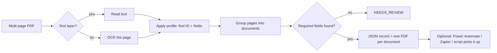

# PDF Form Splitter

**Turn one messy PDF into clean, named documents and structured data, even when it is a scan.**

Offices receive stacks of forms, invoices and letters as a single PDF, often straight from a copier. Someone splits the pages by hand, renames each file, and retypes the data into a tracker. This tool does all three in one run, driven by a simple JSON *profile* per document type. A new document type needs a new profile, not new code.

> Originally built to automate case intake in a real college lab program ([case study](https://github.com/vivalcala/business-systems-portfolio/blob/main/case-studies/01-case-management-weekly-reporting.md)), then generalized. All sample data is fictional.

## What it does



- **Digital or scanned:** OCR runs only on pages without a text layer.
- **One page or many:** `per_page` treats every page as a document; `by_id` keeps pages together until the next ID appears (multi-page invoices).
- **Clean data:** built-in transforms for dates, names, money, padded IDs and fuzzy matching to a known list.
- **Safe by default:** a document missing a required field goes to `NEEDS_REVIEW` instead of producing a wrong record.
- **Automation-ready:** the JSON is written before the PDF, so a flow that triggers on new PDFs always finds the data ready.
- **One-click on Windows:** two `.bat` files for non-technical users.

## Quick start

```bash
pip install -r requirements.txt
mkdir input_pdf && cp samples/sample_invoices.pdf input_pdf/
python split_forms.py --profile profiles/invoice.json
```

Output:

```
Profile: invoice  (mode: by_id)

sample_invoices.pdf  (3 pages)
   page(s) 1-2: 2026-10-03_Northwind_Office_Supply_INV-1042.pdf
   page(s) 3: 2026-10-15_Blue_Harbor_Catering_BH-2026-77.pdf

Done: 2 document(s) saved, 0 need review.
```

`output/_data/2026-10-03_Northwind_Office_Supply_INV-1042.json`:

```json
{
  "invoice": "INV-1042",
  "vendor": "Northwind Office Supply",
  "date": "2026-10-03",
  "total": "238.40",
  "file": "2026-10-03_Northwind_Office_Supply_INV-1042.pdf",
  "sourceFile": "sample_invoices.pdf",
  "pages": [1, 2],
  "profile": "invoice"
}
```

**Windows:** double-click `1_INSTALL_once.bat` once, then `2_RUN_split.bat` (set the profile inside it).

## Write a profile

```json
{
  "name": "invoice",
  "split_mode": "by_id",
  "id_field": "invoice",
  "required": ["invoice", "vendor"],
  "filename": "{date}_{vendor}_{invoice}",
  "fields": {
    "invoice": {"regex": "Invoice\\s*(?:No\\.?|#)\\s*:?\\s*([A-Z0-9-]{3,})", "transform": "upper"},
    "vendor":  {"regex": "^From\\s*:\\s*(.+)$", "transform": "title"},
    "date":    {"regex": "Invoice\\s*Date\\s*:?\\s*(\\d{1,2}/\\d{1,2}/\\d{4})", "transform": "date_iso"},
    "total":   {"regex": "Total\\s*Due\\s*:?\\s*\\$?\\s*([\\d,]+\\.\\d{2})", "transform": "money"}
  }
}
```

| Key | Meaning |
|---|---|
| `split_mode` | `per_page` (each page is a document) or `by_id` (pages continue until the next ID) |
| `id_field` | Field that marks the start of a document |
| `required` | Fields that must be found, or the document goes to review |
| `filename` | Output name built from fields, e.g. `{date}_{vendor}_{invoice}` |
| `fields.*.regex` | Pattern; the first capture group is the value |
| `fields.*.transform` | `date_iso`, `name_last_first`, `title`, `upper`, `money`, `pad_id`, `match_list` |
| `fields.*.options` | Transform options, e.g. `{"items": [...]}` for `match_list`, `{"width": 5}` for `pad_id` |

## Included profiles

| Profile | Mode | Sample |
|---|---|---|
| [`release_form.json`](profiles/release_form.json) | `per_page` | [`sample_release_forms.pdf`](samples/sample_release_forms.pdf) |
| [`invoice.json`](profiles/invoice.json) | `by_id` | [`sample_invoices.pdf`](samples/sample_invoices.pdf) |

## Options

```
python split_forms.py --profile PROFILE [--input DIR] [--output DIR]
```

`--output` (or the `FORM_OUTPUT_FOLDER` variable) can point to a synced OneDrive, Google Drive or Dropbox folder so an automation tool picks up the results.

## Stack

Python · pypdf · pypdfium2 · RapidOCR (ONNX) · JSON profiles
